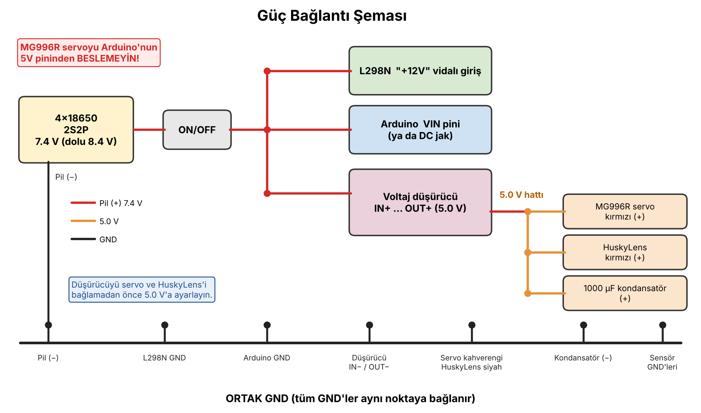

# MECE-309 Otonom Araç: Kurulum ve Kullanım Rehberi

Bu rehber robotun elektronik bağlantılarını, bilgisayara kurulacak programları, kodun nasıl derlenip yükleneceğini, kalibrasyonu ve ayarların nerede değiştirileceğini baştan sona anlatıyor. Sırayla ilerlerseniz başka bir yere bakmanız gerekmez.

---

## 0. Yol haritası

| # | Adım | Bölüm |
|---|---|---|
| 1 | Eksik parçaları alın | [4](#4-malzeme-listesi) |
| 2 | Bilgisayara Arduino IDE'yi ve HuskyLens kütüphanesini kurun | [2](#2-bilgisayara-kurulacaklar) |
| 3 | Kodu açıp derleyin (robot olmadan da yapılabilir) | [3](#3-kodu-açma-derleme-ve-yükleme) |
| 4 | Güç bağlantılarını yapın, voltaj düşürücüyü 5.0 V'a ayarlayın | [5](#5-güç-bağlantısı) |
| 5 | Tüm pin bağlantılarını yapın | [6](#6-pin-bağlantıları) |
| 6 | Sensörleri robota doğru yerlere takın | [7](#7-mekanik-yerleşim) |
| 7 | Bırakma alanı kartını hazırlayın | [8](#8-bırakma-alanı-işareti) |
| 8 | HuskyLens'i eğitin | [9](#9-huskylens-ayarı-ve-eğitimi) |
| 9 | Kalibrasyonu yapın | [10](#10-kalibrasyon) |
| 10 | Görevi çalıştırın | [11](#11-görevi-çalıştırma) |

---

## 1. Proje dosyaları

Proje klasörünün yapısı şöyle:

```
309 Proje/
├── KURULUM_REHBERI.md      ← bu dosya
├── README.md
└── otonom_arac/            ← Arduino projesi (klasör adı DEĞİŞTİRİLMEMELİ)
    ├── otonom_arac.ino     ana program, robotun adımları (durum makinesi)
    ├── ayarlar.h           ★ PİNLER VE TÜM AYARLAR — değişikliklerin %95'i burada
    ├── surus.ino           motorlar, enkoder, konum takibi, düz git / dön
    ├── sensorler.ino       çizgi sensörleri (TCRT5000), ultrasonik (HC-SR04)
    ├── kamera.ino          HuskyLens okuma, kutu ve işaret seçimi
    ├── forklift.ino        servo (MG996R)
    └── kalibrasyon.ino     seri monitörden test komutları
```

**Kurallar:**
- `otonom_arac` klasörünün adı ile `otonom_arac.ino` dosyasının adı **aynı olmak zorunda**. Arduino bunu şart koşar.
- 7 dosya **aynı klasörde** durmalı. Arduino IDE klasördeki bütün `.ino` dosyalarını tek program olarak birleştirir.
- Pin, hız, eşik, servo açısı gibi her şey **sadece `ayarlar.h`** içinden değiştirilir. Diğer dosyalara ancak robotun davranışını değiştirmek isterseniz dokunun.

---

## 2. Bilgisayara kurulacaklar

### 2.1 Arduino IDE

1. https://www.arduino.cc/en/software adresinden **Arduino IDE 2.x**'in Windows sürümünü indirin ve kurun. Kurulumda çıkan sürücü (driver) sorularının hepsine "Yükle" deyin.
2. IDE'yi açın. Sol menüden **Kart Yöneticisi**'ni (Boards Manager, ikinci simge) açın, **"Arduino AVR Boards"** aratın.
   "INSTALLED" yazıyorsa bir şey yapmayın, yazmıyorsa **Install**'a basın. Uno ve Mega bu paketle çalışır.

### 2.2 USB sürücüsü (sadece klon kartlar için)

Türkiye'de satılan Uno ve Mega kartların çoğu klondur ve **CH340** USB çipi kullanır.

1. Kartı USB ile bağlayın.
2. Windows'ta **Aygıt Yöneticisi → Bağlantı Noktaları (COM ve LPT)** bölümüne bakın.
   - `USB-SERIAL CH340 (COM5)` gibi bir satır görüyorsanız sürücü kurulu demektir. Parantez içindeki COM numarasını not edin.
   - Bilinmeyen aygıt ya da sarı ünlem görüyorsanız, https://www.wch-ic.com/downloads/CH341SER_EXE.html adresinden **CH341SER.EXE**'yi indirip kurun ve kartı çıkarıp tekrar takın.

### 2.3 Kütüphaneler

| Kütüphane | Nasıl kurulur |
|---|---|
| **Wire** | Arduino ile birlikte gelir, bir şey yapmayın. |
| **Servo** | IDE'de sol menüden **Kütüphane Yöneticisi**'ni açın (üçüncü simge), "Servo" aratın. Arduino'nun Servo kütüphanesinde "INSTALLED" yazmıyorsa **Install**. |
| **HUSKYLENS** | Aşağıdaki adımlarla **elle** kurulur. |

**HuskyLens kütüphanesi.** Kütüphane Yöneticisi'nde çıkan **"DFRobot_HuskylensV2" bizim kameramıza UYMAZ**, onu kurmayın. Bizim kameramız HuskyLens'in ilk sürümü ve kütüphanesi GitHub'da:

1. https://github.com/HuskyLens/HUSKYLENSArduino adresine gidin. Yeşil **Code** düğmesine, sonra **Download ZIP**'e basın.
2. İnen `HUSKYLENSArduino-master.zip` dosyasını bir yere çıkarın.
3. IDE'de **Dosya → Tercihler** (File → Preferences) açın. **Sketchbook location** satırındaki klasörü not edin. Genelde `C:\Users\<kullanıcı>\Documents\Arduino` olur; OneDrive kullanıyorsanız `...\OneDrive\Belgeler\Arduino` de olabilir.
4. Çıkardığınız klasörün içindeki **`HUSKYLENS`** klasörünü (dış klasörü değil, içindekini) o sketchbook klasörünün altındaki `libraries` klasörüne kopyalayın. `libraries` klasörü yoksa oluşturun.
   Sonuç şöyle görünmeli:
   ```
   ...\Arduino\libraries\HUSKYLENS\HUSKYLENS.h      ← doğru
   ...\Arduino\libraries\HUSKYLENSArduino-master\HUSKYLENS\HUSKYLENS.h   ← YANLIŞ
   ```
5. IDE'yi kapatıp açın. **Dosya → Örnekler** menüsünde "HUSKYLENS" görünüyorsa kurulum tamam.

> **"Add .ZIP Library" menüsünü kullanmayın.** GitHub ZIP'inde kütüphane bir alt klasörde olduğu için o menü hata verir.

---

## 3. Kodu açma, derleme ve yükleme

### 3.1 Arduino IDE ile (önerilen)

1. **Dosya → Aç** ile `otonom_arac\otonom_arac.ino` dosyasını açın. Üstte 7 sekme görünür: `otonom_arac.ino`, `ayarlar.h`, `forklift.ino`, `kalibrasyon.ino`, `kamera.ino`, `sensorler.ino`, `surus.ino`.
2. Kart seçin: **Araçlar → Kart → Arduino AVR Boards →**
   - Uno için **Arduino Uno**
   - Mega için **Arduino Mega or Mega 2560**. Mega'da **Araçlar → İşlemci** satırında "ATmega2560" seçili olsun.
3. Kartı USB ile bağlayın, **Araçlar → Port** menüsünden kartın COM portunu seçin (bölüm 2.2'de not ettiğiniz numara).
4. **Derle:** sol üstteki **✓ (Verify)** düğmesi. Alttaki çıktıda şuna benzer bir satır görmelisiniz:
   ```
   Sketch uses 18394 bytes (57%) of program storage space.
   Global variables use 1133 bytes (55%) of dynamic memory
   ```
   HuskyLens kütüphanesinden gelen turuncu "warning" satırları normaldir, kütüphanenin kendi uyarılarıdır.
5. **Yükle:** **→ (Upload)** düğmesi. "Done uploading" yazınca kod karttadır.

> ⚠️ **Yüklerken robotun tekerleri havada olsun ya da motor pili kapalı olsun.** Görev modundaki kod yüklenir yüklenmez robot hareket etmeye başlar.

> Yükleme sırasında **D0 ve D1 pinlerine hiçbir şey bağlı olmamalı.** Bu pinler USB ile ortak kullanılır, bizim bağlantılarımızda da boş.

### 3.2 Komut satırından (isteğe bağlı)

Arduino CLI kuruluysa (`winget install ArduinoSA.CLI`):

```powershell
cd "C:\...\309 Proje"
arduino-cli compile --fqbn arduino:avr:uno otonom_arac                      # derle (Mega: arduino:avr:mega)
arduino-cli upload  --fqbn arduino:avr:uno -p COM5 otonom_arac              # yükle
arduino-cli monitor -p COM5 -c baudrate=115200                              # seri monitör
```

### 3.3 Seri Monitör

IDE'de sağ üstteki büyüteç simgesi ya da **Araçlar → Seri Port Ekranı**:
- Hız: **115200 baud**.
- Satır sonu: **"Satır Sonu Yok"** ya da **"Yeni Satır"**, ikisi de olur.
- Kalibrasyon komutlarını üstteki kutuya yazıp Enter'a basarak gönderirsiniz.
- Görev modunda robot USB'ye bağlıysa adımlarını buraya yazar (örnek: `[DURUM] 12.4 s -> KUTU_AL`).

> Seri Monitör açıkken kod **yüklenmeyebilir** (port meşgul hatası). Yüklemeden önce kapatın.

---

## 4. Malzeme listesi

| Parça | Adet | Durum |
|---|---|---|
| Arduino Uno **veya** Mega 2560 | 1 | Var |
| L298N motor sürücü | 1 | Var |
| Sarı TT DC redüktörlü motor + 65 mm teker | 2 | Var |
| Sarhoş teker | 1 | Var |
| INR 18650 Li-ion pil + **2S pil yatağı** | 4 | Pil var, yatak/BMS kontrol edin |
| ON/OFF anahtarı | 1 | Pil yatağında var |
| 20 delikli enkoder diski | 2 | Var |
| **LM393 hız sensörü modülü** (yuvalı optik sensör) | 2 | **Alınacak** |
| **Voltaj düşürücü** (XL4015 ya da LM2596, en az 3 A) | 1 | **Alınacak** |
| MG996R servo | 1 | Var |
| TCRT5000 çizgi sensörü modülü (**4 pinli: VCC, GND, DO, AO**) | 2 | Var (AO pini olduğunu kontrol edin) |
| HC-SR04 ultrasonik sensör | 2 (6 var) | Var |
| HuskyLens + 4 pinli Gravity kablosu | 1 | Var |
| 470-1000 µF elektrolitik kondansatör (≥10 V) | 1 | Önerilir (servonun yanına) |
| Erkek-dişi, dişi-dişi jumper kablolar | ~40 | |

> **Enkoder modülü alamazsanız:** `ayarlar.h` içinde `#define ENKODER_VAR 0` yapın. Robot mesafeyi ve dönüşü süreye göre tahmin eder; çalışır ama daha az hassastır.

> **TCRT5000 modülünüzde AO pini yoksa** (sadece 3 pin: VCC, GND, DO), bu kod o modülle çalışmaz; 4 pinli modül alın.

---

## 5. Güç bağlantısı

### 5.1 Şema



### 5.2 Adımlar

1. **Pilleri 2S2P bağlayın:** ikişerli iki grup seri, sonra iki grup paralel. Sonuç 7.4 V nominal (dolu 8.4 V) olur. Bu, L298N'deki ~2 V kayıptan sonra TT motorların istediği 5-6 V'u verir.
   3S (11.1 V) bağlarsanız `ayarlar.h` içinde `PWM_MAX` değerini **170**'e düşürün, yoksa motorlar zorlanır.
2. **L298N:** pil (+) → `+12V` vidalı girişi, pil (−) → `GND`. Kart üzerindeki **"5V-EN" jumper'ı TAKILI kalsın**; L298N kendi mantık beslemesini üretir. L298N'nin `+5V` vidalı ucuna **hiçbir şey bağlamayın**.
3. **Arduino:** pil (+) → **VIN**, pil (−) → **GND**. Arduino 7.4 V'u kendi regülatörüyle 5 V'a düşürür.
   USB ve pil aynı anda bağlı olabilir, Arduino otomatik seçer.
4. **Voltaj düşürücü:**
   1. Pil (+) → `IN+`, pil (−) → `IN−`.
   2. **Servo ve HuskyLens'i bağlamadan önce** multimetreyle `OUT+`/`OUT−` arasını ölçün ve düşürücünün üzerindeki küçük vidayı çevirerek **5.0 V**'a ayarlayın. Yeni düşürücüler genelde daha yüksek voltajla gelir ve HuskyLens'i yakabilir (HuskyLens en fazla 5 V kabul eder).
   3. Sonra `OUT+` → servo kırmızı ve HuskyLens kırmızı, `OUT−` → ortak GND.
5. **Kondansatör:** 1000 µF'ı servo kablosunun yakınında `OUT+`/`OUT−` arasına takın. Uzun bacak (+), çizgili taraf (−). Servo aniden akım çektiğinde voltaj düşmesini engeller.
6. **Ortak GND:** yukarıdaki listedeki her GND aynı noktaya bağlanmalı. Ortak GND yoksa sinyaller anlamsızlaşır; motorlar dönmez ya da sensörler saçma değer okur.

> ❌ **MG996R'yi asla Arduino'nun 5V pininden beslemeyin.** Servo kalkarken 2 A'e kadar çeker, Arduino resetlenir ve robot göreve baştan başlar.

> ⚠️ Li-ion piller kısa devrede çok ısınır. Uygun bir 2S pil yatağı ya da koruma kartı (BMS) kullanın, pilleri uygun bir şarj cihazıyla şarj edin.

---

## 6. Pin bağlantıları

### 6.1 Yönler

- **Robotun önü = çatalın olduğu taraf.**
- **Sol / sağ = robotun arkasında durup önüne bakarken** sizin solunuz ve sağınız.

### 6.2 Ana tablo

| Arduino pini (Uno) | Arduino pini (Mega) | Bağlanan | Kablo ucu |
|---|---|---|---|
| D0, D1 | D0, D1 | **BOŞ** | USB yükleme için |
| D2 | D2 | Sol enkoder modülü | DO |
| D3 | D3 | Sağ enkoder modülü | DO |
| D4 | D4 | L298N | IN1 |
| D5 | D5 | L298N | ENA (jumper çıkarılmış) |
| D6 | D6 | L298N | ENB (jumper çıkarılmış) |
| D7 | D7 | L298N | IN2 |
| D8 | D8 | L298N | IN3 |
| D9 | D9 | MG996R servo | Turuncu (sinyal) |
| D10 | D10 | Sol HC-SR04 | Trig |
| D11 | D11 | Sol HC-SR04 | Echo |
| D12 | D12 | L298N | IN4 |
| D13 | D13 | (kart üstündeki LED) | Bağlantı yok |
| A0 | A0 | Sol TCRT5000 | **AO** |
| A1 | A1 | Sağ TCRT5000 | **AO** |
| A2 | A2 | Sağ HC-SR04 | Trig |
| A3 | A3 | Sağ HC-SR04 | Echo |
| **A4** | **20 (SDA)** | HuskyLens | **T** (yeşil) |
| **A5** | **21 (SCL)** | HuskyLens | **R** (mavi) |
| 5V | 5V | Enkoderler, TCRT5000'ler, HC-SR04'ler | VCC |
| GND | GND | Ortak GND | |

> **Uno ile Mega arasındaki TEK fark HuskyLens'in iki kablosu.** Mega'da A4/A5 I2C pini değildir. Mega'da 20/21 numaralı pinler sağ üst köşedeki "COMMUNICATION" sırasında, üzerinde `SDA 20` ve `SCL 21` yazar. Kodda değişiklik gerekmez.

### 6.3 Parça parça bağlantı

#### L298N motor sürücü

| L298N ucu | Nereye |
|---|---|
| `+12V` | Pil (+), anahtardan sonra |
| `GND` | Ortak GND (pil − ve Arduino GND) |
| `+5V` | **Boş** |
| `5V-EN` jumper | **Takılı kalsın** |
| `ENA` | Jumper'ı **çıkarın**, pimi Arduino **D5**'e bağlayın |
| `IN1` | **D4** |
| `IN2` | **D7** |
| `IN3` | **D8** |
| `IN4` | **D12** |
| `ENB` | Jumper'ı **çıkarın**, pimi Arduino **D6**'ya bağlayın |
| `OUT1`, `OUT2` | **Sol motor** |
| `OUT3`, `OUT4` | **Sağ motor** |

ENA/ENB'deki jumper çıkarılmazsa motorlar hız kontrolü olmadan hep tam hızda döner. ENA/ENB'de ikişer pim vardır; biri kartın 5V hattına bağlıdır, diğeri sinyal girişidir. Jumper'ı çıkardıktan sonra L298N'yi besleyip multimetreyle iki pimi GND'ye göre ölçün: **5 V gösteren pime dokunmayın, 0 V gösteren pime Arduino kablosunu takın.**

Motor kablolarının hangi ucunun OUT1, hangisinin OUT2'ye gittiği önemli değil. Ters dönerse kalibrasyonda (bölüm 10, adım 1) koddan düzeltilir.

#### Enkoderler (LM393 hız sensörü modülü)

| Modül ucu | Sol modül | Sağ modül |
|---|---|---|
| VCC | 5V | 5V |
| GND | GND | GND |
| DO (ya da OUT/D0) | **D2** | **D3** |
| AO (varsa) | Boş | Boş |

Enkoder diskini TT motorun **arka çıkıntı miline** takın. Disk modülün **U şeklindeki yuvasının ortasından** sürtmeden geçmeli. Modülü motora sıcak silikon ya da vida ile sabitleyin.

> Enkoderler başka pine **taşınamaz**. Uno'da kesme (interrupt) özelliği yalnızca D2 ve D3'te vardır.

#### MG996R servo (forklift)

| Servo kablosu | Nereye |
|---|---|
| Kahverengi | Ortak GND |
| Kırmızı | Voltaj düşürücü **OUT+ (5.0 V)** |
| Turuncu | Arduino **D9** |

#### TCRT5000 çizgi sensörleri

| Modül ucu | Sol | Sağ |
|---|---|---|
| VCC | 5V | 5V |
| GND | GND | GND |
| **AO** | **A0** | **A1** |
| DO | Boş | Boş |

Modülün üzerindeki ayar vidası sadece DO çıkışını etkiler. Biz AO kullandığımız için **o vidayla oynamanız gerekmez**; eşik koddan ayarlanır.

#### HC-SR04 ultrasonik sensörler

| Sensör ucu | Sol | Sağ |
|---|---|---|
| VCC | 5V | 5V |
| Trig | **D10** | **A2** |
| Echo | **D11** | **A3** |
| GND | GND | GND |

A2 ve A3 analog pin olarak geçse de dijital pin olarak çalışır, sorun yok.

#### HuskyLens

HuskyLens'in Gravity kablosunda 4 renk var:

| Kablo | İşaret | Uno | Mega |
|---|---|---|---|
| Yeşil | T | **A4** | **20 (SDA)** |
| Mavi | R | **A5** | **21 (SCL)** |
| Siyah | − | GND | GND |
| Kırmızı | + | Voltaj düşürücü 5.0 V | Voltaj düşürücü 5.0 V |

### 6.4 Pinleri değiştirmek isterseniz

Pin numaraları `ayarlar.h` içindeki `PIN_...` satırlarında. Değiştirirken:
- **Enkoderler** sadece kesme pinlerinde çalışır: Uno'da 2, 3; Mega'da 2, 3, 18, 19.
- **ENA / ENB**, PWM pinlerinde (~ işaretli) olmalı. Uno'da **9 ve 10 kullanılamaz**, çünkü Servo kütüphanesi bu pinlerin PWM'ini kapatır. 3, 5, 6, 11 uygundur.
- **D0 / D1**'i kullanmayın.
- HuskyLens pinleri değiştirilemez; I2C donanımına bağlıdır.

---

## 7. Mekanik yerleşim

Kod aşağıdaki yerleşimi varsayıyor. Farklı yaparsanız ilgili ayar değerleri değişir.

| Parça | Yer | Neden |
|---|---|---|
| **HuskyLens** | Robotun **orta ekseninde**, çatalla aynı hizada. **Yerden ≥ 15 cm** yükseklikte, hafif aşağı bakar. | Kod, kameranın ortasını çatalın ortası kabul eder. Taşınan kutunun (10 cm) üstünden alanı görebilmesi gerekir. |
| **Çatal** | Kalınlık < 15 mm, genişlik ~40 mm, ucu sivri. Aşağıdayken yerden ~5 mm yüksekte. | Kutunun altındaki kanal 60 mm geniş, 20 mm yüksek. Sivri uç küçük hizalama hatalarında çatalı kanala yönlendirir. |
| **TCRT5000 ×2** | Ön altta, tekerleklerin **önünde**. Aralarında ~10 cm, zeminden 3-8 mm yukarıda, aşağı bakar. | Tekerlekler çizgiyi geçmeden çizgiyi görmeleri gerekir. İki sensör, robotun çizgiye dik hizalanmasını sağlar. |
| **HC-SR04 ×2** | Ön köşelerde, **kutunun genişliğinin dışında**, ~15° dışa dönük, yerden 5-8 cm. | Taşınan kutu önlerini kapatmasın. Engelin yüksekliği bilinmiyor, alçak sensör kısa engeli de görür. |
| **Enkoderler** | Motorların arka milinde. | |
| **Sarhoş teker** | Arkada. | |

Robotun **teker merkezleri arası mesafesini** (iki tekerin yere değdiği noktalar arası) ölçüp `ayarlar.h` → `TEKER_ARASI_MM` satırına yazın. Kalibrasyonda bu değer ince ayarlanacak.

---

## 8. Bırakma alanı işareti

HuskyLens yerdeki ince bandı uzaktan güvenilir göremez. Bu yüzden alanın **arka kenarına dik duran renkli bir kart** koyuyoruz:

```
          ┌───────────────┐   ← renkli kart (~15 cm genişlik), alt kenarı yerden ~13 cm yukarıda
          │     MAVİ      │
          └───────┬───────┘
                  │  ayak / çubuk
   ┌──────────────┴──────────────┐
   │                             │   30 × 30 cm alan (bantla çevrili)
   │    [kutu]  [kutu]  [kutu]   │
   └─────────────────────────────┘   ← robot buradan, ön çizgiden yaklaşır
               ▲ robot
```

- **Renk:** mavi ya da yeşil. Kırmızı (kutu), kahverengi (tahta engel), siyah veya beyaz (sınır bandı) olmamalı. Mat karton seçin; parlak yüzey ışığı yansıtır.
- **Genişlik:** ~15 cm. Farklı yaparsanız `ayarlar.h` → `ISARET_GENISLIK_MM` değerini güncelleyin.
- **Yükseklik:** kartın renkli kısmının **alt kenarı kutuların üstünde** kalmalı (yerden ~13 cm). Kod, kartın altında görünen kırmızıları "daha önce bırakılmış kutu" sayar ve tekrar almaya çalışmaz.
- **Sadece ön yüzü renkli olsun ve sahaya baksın.** Böylece robot alana hep aynı taraftan yaklaşır ve kutular aynı sıraya dizilir.

---

## 9. HuskyLens ayarı ve eğitimi

### 9.1 İletişim ayarı (bir kez)

1. HuskyLens'i çalıştırın. **Fonksiyon düğmesini** (sol üstteki döner düğme) sağa çevirerek **General Settings**'e gelin, düğmeye basın.
2. **Protocol Type**'a gelin, basın, **I2C** seçin, basın.
3. **Save & Return** ile kaydedip çıkın.

### 9.2 Renk öğretme

1. Fonksiyon düğmesiyle **Color Recognition** moduna gelin.
2. Fonksiyon düğmesine **uzun basın** (parametre ayarları açılır). **Learn Multiple**'ı bulun ve **açın** (ON). **Save & Return** ile çıkın.
3. **ID1 = kırmızı kutu:** ekrandaki artıyı kutunun ortasına tutun. **Öğrenme düğmesini** (sağ üstteki düğme) **basılı tutun**. Sarı çerçeve kutunun rengini kaplayınca düğmeyi bırakın.
4. Ekranda "Click again to continue! Click other button to finish" yazar. Geri sayım bitmeden öğrenme düğmesine **kısa** basın; sıradaki ID'yi öğrenmeye geçer.
5. **ID2 = alan kartı:** artıyı mavi/yeşil karta tutun, öğrenme düğmesini **basılı tutun**, çerçeve kartı kaplayınca bırakın.
6. Aynı yazı tekrar çıkınca bu sefer **fonksiyon düğmesine** kısa basın (ya da geri sayımın bitmesini bekleyin). Öğrenme biter.
7. Kontrol: kutuya bakınca ekranda **"ID1"**, karta bakınca **"ID2"** yazmalı.

**Yeniden öğretmek için:** Color Recognition modundayken öğrenme düğmesine kısa basın, ekranda "Click again to forget" yazar, geri sayım bitmeden tekrar basın. Tüm renkler silinir; adım 3'ten başlayın.

**İpuçları:**
- **Gösterimin yapılacağı odada, o odanın ışığında** öğretin. Işık değişirse yeniden öğretin.
- Öğrettikten sonra kutuyu farklı mesafelerden (20 cm - 2 m) ve açılardan gösterip ID1'in sürekli göründüğünü kontrol edin.
- Tahta engelde ya da sahanın çevresinde **ID1 görünmemeli**. Görünüyorsa kutuyu daha yakından ve daha kırmızı bir bölgesinden yeniden öğretin.

---

## 10. Kalibrasyon

### 10.1 Kalibrasyon moduna geçme

1. `ayarlar.h` dosyasını açın, şu satırı bulun ve `0` olan değeri `1` yapın:
   ```cpp
   #define CALISMA_MODU 1
   ```
2. Kodu yükleyin. Seri Monitör'ü **115200** baud ile açın. Komut listesi ekrana gelir:
   ```
   k : kamera bloklarini yazdir (5 s)
   i : cizgi sensorleri (5 s)
   ...
   ```
3. Bir komut harfi yazıp Enter'a basın. Bir değeri değiştirdiğinizde `ayarlar.h`'yi kaydedin ve **kodu tekrar yükleyin**.

> Kalibrasyon modunda robot açılışta HuskyLens'i ~3 saniye bekler, bulamazsa kamerasız devam eder. Böylece kamera bağlı değilken de motorları test edebilirsiniz.

> Komut gönderirken robotun yanında durun: `f`, `g`, `d`, `r`, `m` komutları robotu hareket ettirir.

### 10.2 Adımlar

| # | Komut | Ne yapılır | `ayarlar.h`'de ne değişir |
|---|---|---|---|
| 1 | `m` | Önce sol teker 1 s ileri, 1 s geri döner, sonra sağ teker aynısını yapar. Ekrandaki "ileri" yazısında teker robotu öne götürecek yönde dönmeli. | Ters dönen taraf için `SOL_MOTOR_TERS` ya da `SAG_MOTOR_TERS` = `true`. |
| 2 | `e` | 10 s boyunca tekerleri **elle ileri** çevirin. İki sayaç da artmalı (tur başına ~40). | Artmıyorsa kablo ve diski kontrol edin. |
| 3 | `f` | Robot 500 mm ileri gitmeye çalışır. Gerçekte gittiği mesafeyi metreyle ölçün. | Enkoderliyse: `TEKER_CAP_MM = 65 × ölçülen / 500`. Enkodersizse: `TAM_HIZ_MM_S = eski değer × 500 / ölçülen`. |
| 4 | `d` | Robot 360° dönmeye çalışır. Gerçekte döndüğü açıyı tahmin edin (yere bant koyup işaretleyin). | `TEKER_ARASI_MM = eski değer × 360 / gerçek açı`. 2-3 kez tekrarlayın. |
| 5 | `s20`, `s40`, `s70` … | Servoyu açılara götürüp deneyin. | Çatalın yerden ~5 mm yüksekte, kanala girebildiği açı `FORK_ALT_DERECE`. Kutunun yerden 1-2 cm kalktığı açı `FORK_UST_DERECE`. |
| 6 | `i` | Sensörleri önce zemine, sonra banda (siyah ve beyaz, ikisi de) ve alanın renkli bandına tutun. Değerleri not edin. | Zemin ile bant arasındaki farkın **yarısını** `IR_ESIK_FARK` yapın. |
| 7 | `u` | Önce sensörlerin önünü boş bırakın, sonra 20 cm'ye elinizi koyun. Ardından kutuyu çatala koyup tekrar ölçün. | Kutu çataldayken okunan değer `TASIMA_KOR_CM`'den küçük olmalı. Değilse `TASIMA_KOR_CM`'i biraz artırın ya da sensörleri daha dışa çevirin. |
| 8 | `k` | Kutuyu çatal ucunun ~3 cm önüne koyun, `w` değerini okuyun. Çatalın kutunun altına tamamen girmesi için robotun daha ne kadar ilerlemesi gerektiğini ölçün. | Okunan `w` → `KUTU_YAKIN_GENISLIK`. Ölçülen mesafe → `SON_ITIS_MM`. |
| 9 | `k` | Kutuyu kameradan 50 cm'ye koyun, `w`'yu okuyun. Kartı 100 cm'ye koyun, `w`'yu okuyun. | `KUTU_MESAFE_K = kutu w × 500`. `ISARET_MESAFE_K = kart w × 1000`. |
| 10 | `k` | Robotu, TCRT sensörleri alanın ön çizgisinin üstünde olacak şekilde koyun, kartın `w`'sunu okuyun. | Okunan değerin ~%80'i → `ISARET_YAKIN_GENISLIK`. |
| 11 | `a`, `y` | Çatalı indirip kaldırın, adım 5'teki açıları doğrulayın. | |
| 12 | `o` | İstediğiniz an robotun konum tahminini görürsünüz. | |

Kalibrasyon bitince `#define CALISMA_MODU 0` yapıp tekrar yükleyin.

---

## 11. Görevi çalıştırma

1. `ayarlar.h` → `#define CALISMA_MODU 0` olsun, kodu yükleyin.
2. USB kablosunu çıkarın.
3. Robotu sahaya, **düz zeminin üstüne** koyun. Çizginin, kutunun ya da işaretin üstüne koymayın.
4. Pil anahtarını açın ve **ilk 1-2 saniye robota dokunmayın.** Robot bu sırada HuskyLens'in açılmasını bekler ve zeminin rengini ölçer. Sınır bandının siyah mı beyaz mı olduğunu bu ölçümle anlar.
5. Robot kendiliğinden başlar.

**LED (D13, kartın üstündeki "L" LED'i) ne anlatıyor:**

| LED | Anlamı |
|---|---|
| Hızlı yanıp sönüyor (açılışta) | HuskyLens bekleniyor. Uzun sürerse bkz. [Sorun giderme](#14-sorun-giderme). |
| Sürekli yanıyor | Robot bir kutu taşıyor. |
| Sönük | Robot kutu arıyor ya da alana gidiyor. |
| Yavaş yanıp sönüyor (1 sn) | 3 kutu bırakıldı ya da 10 dakika doldu, görev bitti. |

Bir denemeden sonra yeniden başlatmak için pil anahtarını kapatıp açın.

---

## 12. `ayarlar.h` referansı: neyi neden değiştirirsiniz

### Mod

| Ayar | Varsayılan | Açıklama |
|---|---|---|
| `CALISMA_MODU` | `0` | `0` görev, `1` kalibrasyon menüsü. |
| `ENKODER_VAR` | `1` | Enkoder modülü takılı değilse `0`. |

### Motorlar

| Ayar | Varsayılan | Ne zaman değişir |
|---|---|---|
| `SOL_MOTOR_TERS`, `SAG_MOTOR_TERS` | `false` | Teker ters dönüyorsa (kalibrasyon adım 1). |
| `PWM_MIN` | `90` | Robot düşük hızda kıpırdamıyorsa artırın (100-120). |
| `PWM_MAX` | `255` | 3S pil kullanırsanız 170. |
| `SAG_TRIM` | `1.00` | Sadece enkodersiz modda: robot sola kayıyorsa 0.95, sağa kayıyorsa 1.05 gibi. |
| `HIZ_NORMAL` | `70` | Genel hız (%). Robot güvenilir çalışınca artırarak süreyi kısaltın. |
| `HIZ_YAVAS` | `45` | Hedefe yakınken ve manevralarda. |
| `HIZ_INCE` | `35` | Son hizalama ve çizgiye dik durma. Tekerler bu hızda dönmüyorsa artırın. |
| `HIZ_DONUS` | `55` | Yerinde dönüş hızı. |
| `HIZ_TARAMA` | `50` | Arama sırasında dönüş hızı. |
| `KP_DUZ` | `150` | Düz giderken yön düzeltme kuvveti. Robot yılan gibi sağa sola yalpalıyorsa azaltın. |

### Geometri ve enkoder

| Ayar | Varsayılan | Açıklama |
|---|---|---|
| `TEKER_CAP_MM` | `65.0` | Kalibrasyon adım 3. |
| `TEKER_ARASI_MM` | `150.0` | **Mekanik tasarımdan sonra ölçün**, kalibrasyon adım 4. |
| `ENK_DELIK` | `20` | Diskteki delik sayısı. |
| `ENK_DEBOUNCE_US` | `1500` | Sayaçlar zıplıyorsa artırın. Genelde dokunmayın. |
| `TAM_HIZ_MM_S` | `450.0` | Sadece enkodersiz modda önemli, kalibrasyon adım 3. |

### Forklift

| Ayar | Varsayılan | Açıklama |
|---|---|---|
| `FORK_ALT_DERECE` | `20` | Çatal aşağıda (kalibrasyon adım 5). |
| `FORK_UST_DERECE` | `70` | Çatal yukarıda, kutu kalkmış. |
| `FORK_ADIM_MS` | `8` | Kaldırma yumuşaklığı. Kutu sarsılıyorsa artırın, hız için azaltın. |

### Sensörler

| Ayar | Varsayılan | Açıklama |
|---|---|---|
| `IR_ESIK_FARK` | `150` | Kalibrasyon adım 6. Robot boş zeminde çizgi görüyorsa artırın, çizgiyi kaçırıyorsa azaltın. |
| `ENGEL_MESAFE_CM` | `25` | Bundan yakın nesne engel sayılır. |
| `TASIMA_KOR_CM` | `12` | Kutu taşınırken bundan yakın okumalar yok sayılır (kutunun kendi yankısı). |

### Kamera

| Ayar | Varsayılan | Açıklama |
|---|---|---|
| `KUTU_ID`, `ISARET_ID` | `1`, `2` | HuskyLens'te öğretilen ID'ler. Sırayı değiştirmeyin. |
| `KUTU_MIN_GENISLIK` | `12` | Bundan küçük kırmızı lekeler gürültü sayılır. |
| `KUTU_YAKIN_GENISLIK` | `110` | Kalibrasyon adım 8. |
| `KUTU_US_KAPAT_GENISLIK` | `60` | Kutu bu kadar büyük görünürse ultrasonik yok sayılır (kutunun kendisini engel sanmasın). |
| `ISARET_YAKIN_GENISLIK` | `90` | Kalibrasyon adım 10. |
| `KP_HIZALAMA` | `0.25` | Hedefe dönme kuvveti. Robot hedefe yalpalayarak gidiyorsa azaltın, geç dönüyorsa artırın. |
| `HIZALAMA_TOLERANS_PX` | `10` | Son hizalamada kabul edilen hata (piksel). |
| `HEDEF_KAYIP_MS` | `400` | Hedef bu kadar süre görünmezse robot yeniden aramaya başlar. |
| `KUTU_MESAFE_K`, `ISARET_MESAFE_K` | | Kalibrasyon adım 9. |
| `ISARET_GENISLIK_MM` | `150.0` | Kartın gerçek genişliği. |
| `KAMERA_DERECE_PIKSEL` | `0.19` | Genelde dokunmayın. |

### Görev

| Ayar | Varsayılan | Açıklama |
|---|---|---|
| `KUTU_SAYISI` | `3` | Görev açıklamasında sayı değişirse. |
| `SON_ITIS_MM` | `130` | Kalibrasyon adım 8. |
| `BIRAKMA_ARALIK_MM` | `160` | Kutu merkezleri arası mesafe (10 cm kutu + 6 cm boşluk). Boşluk 5-10 cm olmalı → 150-200 arası. |
| `BIRAKMA_GERI_MM` | `150` | Yana kaymadan önce geri çekilme. Yan kutuya çarpıyorsa artırın. |
| `BIRAKMA_ILERI_EK_MM` | `0` | Kutular alanın içine yeterince girmiyorsa artırın. |
| `BIRAKMA_SONRASI_GERI_MM` | `200` | Bıraktıktan sonra geri çekilme. |
| `BIRAKMA_SIRASI` | `{1, -1, 0}` | `1` sağ, `-1` sol, `0` orta. **Orta en sonda kalmalı.** |
| `KACINMA_GERI_MM`, `KACINMA_ILERI_MM` | `100`, `250` | Engel ve çizgiden kaçarken geri çekilme ve ilerleme. |
| `KESIF_ILERI_MM` | `500` | Tam turda bir şey bulamazsa bu kadar ileri gider. |
| `TARAMA_ADIM_DERECE` | `30` | Arama adımı. |
| `TARAMA_BEKLEME_MS` | `150` | Her adımda kameraya tanınan süre. Hedefi kaçırıyorsa artırın. |
| `YERLESMIS_YARICAP_MM` | `350` | Alana bu kadar yakın kırmızılar "bırakılmış kutu" sayılır. |
| `GOREV_SURESI_MS` | `600000` | 10 dakika sonra robot durur. |

---

## 13. Robot nasıl çalışıyor

```
KUTU_ARA ──görüldü──▶ KUTUYA_YAKLAS ──yakın──▶ KUTU_AL ──▶ ALAN_ARA
   ▲                                                          │
   │                                                       görüldü
   │                                                          ▼
KUTU_BIRAK ◀── ALAN_HIZALAN ◀──alan çizgisi── ALANA_YAKLAS
   │
   └── 3 kutu bitti ──▶ BITTI
```

- **KUTU_ARA:** robot 30°'lik adımlarla yerinde döner, her adımda kameraya bakar. Tam turda bir şey bulamazsa 50 cm ileri gidip tekrar tarar.
- **KUTUYA_YAKLAS:** kutuyu görüntünün ortasında tutarak ilerler. Uzaktayken hızlı, yakında yavaş gider.
- **KUTU_AL:** son hizalamayı yapar, çatalı indirir, `SON_ITIS_MM` kadar ileri gider, kaldırır.
- **ALAN_ARA:** alanın yerini daha önce gördüyse önce o yöne döner, görmediyse tam tur tarar.
- **ALANA_YAKLAS:** kartı görüntünün ortasında tutarak ilerler.
- **ALAN_HIZALAN:** kart yakındayken görülen çizgi alanın çizgisidir. Robot, iki çizgi sensörü de çizgiyi görene kadar tekerleri ayrı ayrı ilerletir; böylece çizgiye dik durur ve kutular aynı açıyla bırakılır.
- **KUTU_BIRAK:** bırakma sırası **sağ, sol, orta**. Robot her seferinde hâlâ boş olan ortadan hizalanır. Sağ ve sol kutular için geri çekilir, 90° döner, yana kayar, tekrar çizgiye dik döner ve bırakır.
- **Sınır:** kart uzaktayken görülen çizgi saha sınırıdır. Robot geri çekilir ve 135° döner.
- **Engel:** ultrasonik 25 cm'den yakın bir şey görürse robot geri çekilir, engelden uzak tarafa 60° döner ve 25 cm ilerler.
- **Süre:** 10 dakika dolunca robot durur.

---

## 14. Sorun giderme

| Belirti | Olası neden | Çözüm |
|---|---|---|
| Derlemede `HUSKYLENS.h: No such file or directory` | Kütüphane yanlış klasörde | Bölüm 2.3: `libraries\HUSKYLENS\HUSKYLENS.h` yolu doğru mu? IDE'yi yeniden başlatın. |
| Yüklemede `not in sync` ya da `access denied` | Yanlış kart/port, ya da port meşgul | Kart ve port seçimini kontrol edin, Seri Monitör'ü kapatın, USB'yi çıkarıp takın. |
| Port menüsünde kart görünmüyor | CH340 sürücüsü yok | Bölüm 2.2. |
| LED açılışta sürekli hızlı yanıp sönüyor | HuskyLens'e ulaşılamıyor | HuskyLens'in Protocol Type ayarı I2C mi? T ve R kabloları yer değiştirmiş olabilir. Mega'da 20/21'e takılı mı? HuskyLens'in beslemesi var mı? |
| Robot hiç hareket etmiyor | Motor gücü ya da ortak GND yok | Pil anahtarı açık mı? L298N GND, Arduino GND'ye bağlı mı? ENA/ENB kabloları takılı mı? |
| Motorlar hep tam hızda dönüyor | ENA/ENB jumper'ları takılı | Jumper'ları çıkarıp D5/D6'ya bağlayın. |
| Robot düz gitmek yerine yerinde dönüyor | Bir motor ters | Kalibrasyon adım 1. |
| Servo kalkınca Arduino resetleniyor | Servo Arduino'dan besleniyor ya da voltaj düşüyor | Servo voltaj düşürücüden beslenmeli, kondansatör ekleyin. |
| Robot boş zeminde "çizgi" görüp kaçıyor | Eşik düşük, sensör çok yüksekte ya da robot çizginin üstünde açıldı | `IR_ESIK_FARK`'ı artırın, sensörü 3-8 mm'ye indirin, robotu düz zeminde açın. |
| Robot sınırı geçiyor | Eşik yüksek ya da sensörler tekerin arkasında | `IR_ESIK_FARK`'ı azaltın, sensörleri öne alın. |
| Kutu taşırken sürekli "engel" görüyor | Kutu ultrasoniğin önünü kapatıyor | Sensörleri daha dışa çevirin ya da `TASIMA_KOR_CM`'i artırın. |
| Kutuyu görüyor ama çatal kutuya çarpıyor | Hizalama ya da yaklaşma mesafesi yanlış | Kalibrasyon adım 8. Kamera robotun tam ortasında mı? |
| Çatal kutunun altına girmeden kaldırıyor | `SON_ITIS_MM` kısa | Artırın. |
| Robot kutuya çok yaklaşıp itiyor | `KUTU_YAKIN_GENISLIK` büyük | Azaltın. |
| Robot alana bıraktığı kutuyu tekrar almaya gidiyor | Kart kutuların arkasında görünmüyor ya da kart çok alçak | Kartı yükseltin (bölüm 8), `YERLESMIS_YARICAP_MM`'i artırın. |
| Robot hiçbir şey görmeden sürekli dönüyor | HuskyLens eğitilmemiş ya da ışık değişmiş | Bölüm 9.2'yi gösterim odasında tekrarlayın. Kalibrasyonda `k` ile kontrol edin. |
| Robot yanlış açıyla dönüyor | `TEKER_ARASI_MM` yanlış | Kalibrasyon adım 4. |

---

## 15. Bilinen riskler

- **Kod Uno ve Mega için hatasız derleniyor ama henüz gerçek robotta denenmedi.** Varsayılan kalibrasyon değerleri tahmini; bölüm 10 mutlaka yapılmalı.
- **Alan genişliği:** üç kutu ve aralarındaki 6 cm boşluk ~44 cm eder, 30 cm'lik alana sığmaz; dıştaki kutular alanın kenarından taşar. Hoca "çizginin üstüne veya arkasına" dediği için sorun olmayabilir. Gerekirse `BIRAKMA_ARALIK_MM` değerini 150'ye düşürün (5 cm boşluk).
- **Döndürülmüş kutular:** kutu robota çapraz duruyorsa çatal ayaklara çarpabilir. Sivri çatal ucu bunu azaltır.
- **Sahanın çevresindeki kırmızı nesneler:** robot onlara doğru gidip sınırda dönmeye devam edebilir. Gösterimde sahanın çevresinde kırmızı bir şey (kıyafet, çanta) olmasın.
- **Işık:** HuskyLens'in renk tanıması ışığa bağlı. Gösterim günü, o odada yeniden eğitin.
